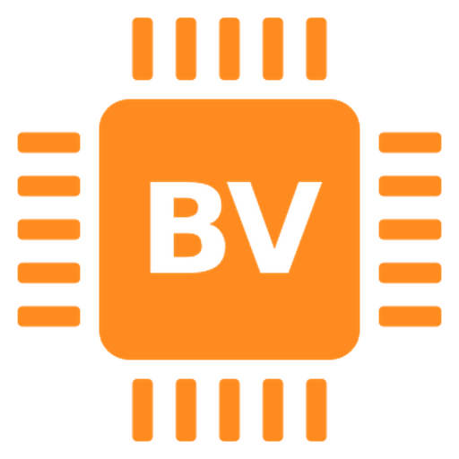

<p align="center"></p>

<h1 align="center">BoardV</h1>

<p align="center">Просмотр плат Altium на ПК и телефоне: открываете <code>.PcbDoc</code> — и сразу видите детали, цепи, номиналы и BOM.</p>

<p align="center">
  <a href="https://github.com/Carn1son/BoardV/releases/latest/download/BoardV.apk"><b>Android (APK)</b></a> ·
  <a href="https://github.com/Carn1son/BoardV/releases/latest/download/BoardV-Setup.exe"><b>Windows — установщик</b></a> ·
  <a href="https://github.com/Carn1son/BoardV/releases/latest/download/BoardV-portable.exe"><b>Windows — без установки</b></a>
</p>

## Что умеет

### Форматы
- **Altium .PcbDoc** открывается напрямую, без экспорта.
- Boardview и CAD: `.brd` (Test_Link, в том числе зашифрованные, BRD2, Eagle), `.bdv`, `.bvr`, `.asc`, `.cad` (GenCAD и ###Panel), `.cst`, KiCad `.kicad_pcb`, а также `.zip` с платой внутри.
- Если в файле нет номиналов, можно добавить **BOM или файл расстановки (CSV)**: перетащите его вместе с платой.
- Для закрытых форматов (Allegro `.brd`, ASUS `.fz`, XZZ `.pcb`, `.cae`) программа объясняет, что именно экспортировать, чтобы файл открылся.

### Плата и цепи
- Верх, низ (зеркально) или обе стороны, поворот, переворот платы.
- Клик по пину подсвечивает **всю цепь** со свечением. Питание и земля окрашены отдельно, компоненты на противоположном слое показаны бегущим пунктиром.
- **Свои цвета цепей**: правила по имени или маске (например `VCC*`, `*GND*`).
- Поиск по деталям, цепям и номиналам.
- Карточка детали: позиционное обозначение, номинал, корпус, пины и их цепи. Рядом с номиналом и именем цепи есть кнопки **копирования** и **поиска даташита** (Google, `"название" filetype:pdf`).
- Любой текст в карточке и списках копируется правой кнопкой мыши или долгим нажатием на телефоне.

### BOM
- Панель BOM справа: клик по позиции показывает все места установки сверху и снизу платы.
- Копирование BOM в CSV для Excel или Google Таблиц.
- **Выгрузка BOM в .xlsx** с отметками проверки: найденные позиции зелёные, частично совпавшие жёлтые, с фактическим наименованием.

### Телефон как сканер компонентов (по локальной сети)
- На ПК нажмите кнопку с телефоном («Подключить телефон-сканер») и отсканируйте QR-код в BoardV на телефоне.
- Телефон читает QR, DataMatrix и штрихкоды с катушек и лент. Партномер очищается от лишних символов и расшифровывается: для конденсаторов и резисторов Murata, Samsung, Yageo, TDK, Taiyo Yuden, Walsin, KOA, Vishay, Panasonic и других определяются номинал, напряжение, допуск и корпус.
- Компьютер сверяет результат со своим BOM и сразу отвечает телефону: **подходит**, **подходит частично** (номинал совпадает, но отличается, например, напряжение или корпус) или **нет в BOM**. Найденные позиции отмечаются в BOM на ПК, ошибочную отметку можно снять.
- Связь идёт напрямую по Wi-Fi, без интернета и сторонних серверов. Данные **зашифрованы**, код подключения одноразовый, каждое подключение подтверждается на компьютере.
- Статус всегда виден: «Телефон подключён» (зелёный) или «Телефон отсоединён» (красный) с кнопками «Подключить снова» и «Закрыть». Если телефон на время пропал, он переподключится сам, когда BoardV снова откроется в той же сети.
- Если компьютер завершил связь, телефон закрывает сканер и показывает «Связь с ПК разорвана». Если ответа просто нет, ничего не закрывается.
- Если не подключается: телефон и ПК должны быть в одной (не гостевой) Wi-Fi сети, VPN на телефоне выключен или разрешает локальную сеть, BoardV разрешён в брандмауэре Windows для частной сети.

### Оформление и управление
- Темы, режимы **День / Ночь**, настройка цветов, подписей, заливки, обводки и выделения. Каждую группу можно вернуть к значениям темы кнопкой «Сброс».
- Интерфейс на русском и английском.
- Горячие клавиши работают в любой раскладке и переназначаются. На ПК настраиваются скорость и инверсия колёсика.
- На телефоне: жесты, нижняя панель-шторка, кнопка «Назад» закрывает открытые окна и сканер, а не приложение.
- Настройки выгружаются в файл и загружаются на другом устройстве.
- Приложения сами проверяют обновления (можно отключить «Проверять при запуске») и ставят их после подтверждения.

## Установка
- **Android:** скачайте `BoardV.apk`, откройте и разрешите установку. Следующие версии ставятся поверх, из самого приложения: *Настройки → Обновления*.
- **Windows:** `BoardV-Setup.exe` — обычная установка, `.PcbDoc` открываются двойным кликом, обновления из программы. `BoardV-portable.exe` — запуск без установки.
  Windows может показать «Неизвестный издатель» — *Подробнее → Выполнить в любом случае* (программа не подписана платным сертификатом).

## Сборка
Каждый push в `main` собирает APK и `.exe` в GitHub Actions и публикует их в [Releases](https://github.com/Carn1son/BoardV/releases).

```
src/        исходники вьювера (viewer-ui.html, core.js, pcbdoc.js) и сборка build_apps.py
www/        готовое веб-приложение, которое показывают обе обёртки
android/    обёртка WebView (Java): выбор файлов, сохранение настроек, установка обновлений
electron/   обёртка для Windows: открытие плат двойным кликом, обновления
```
